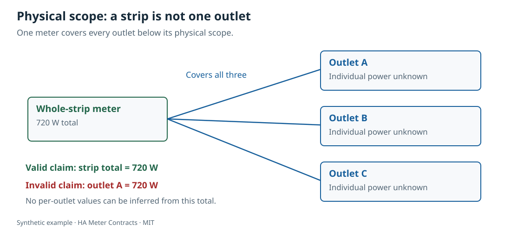

# HA Meter Contracts

The full guides and checked-in wiki pages are available in **24 documentation languages**. See the [language index and maintenance guide](docs/translations.md). CLI message languages remain English, Russian, German and Spanish.

[](https://www.bestpractices.dev/projects/15566)

Read-only validation of **what a meter measures**, how readings may be combined, and whether a sample is usable. Works offline with JSON or YAML. No Home Assistant token, network connection, or device command is used.

[Русский](README.ru.md) · [Deutsch](README.de.md) · [Español](README.es.md)

A three-outlet strip with one meter reports the strip total. Renaming that reading “pump power” does not make it an individual pump measurement. Two Home Assistant or MQTT representations of one CT also remain one measurement. This tool catches those declared-topology mistakes before numbers enter a dashboard or automation.



## Install and run

Python 3.11 or later. From a downloaded source checkout:

```sh
python3 -m venv .venv
.venv/bin/python3 -m pip install .
.venv/bin/ha-meter-contracts check examples/valid-three-meters.json --at 2026-01-01T12:00:05Z
.venv/bin/ha-meter-contracts check examples/kmc-shared-meter.json --at 2026-01-01T12:00:05Z --json --lang en
```

The first example produces **720 W** from three independent synthetic meters. The second deliberately exits **1** with `scope_outside` and no numeric sum: a whole-strip reading cannot identify outlet A. The examples use a fixed historical evaluation time so the results are reproducible. Omit `--at` for the current UTC time when checking actual recent samples.

This source release is not a claim of PyPI publication or physical device testing.

## What is checked

- Strict field names, bounded inputs, timezone-aware timestamps, finite numbers and unique IDs.
- Parent/child cycles, missing scopes, overlapping measurements and duplicate physical provenance.
- Declared complete coverage; a missing or stale member does not silently become zero.
- W/kW and Wh/kWh conversion, dimension compatibility, sign and energy-counter reset semantics.
- Sample age, inter-meter time skew and calibration evidence for the specific measured quantity.
- `measured` versus `estimated` results. A voltage calibration never implies power calibration.

[Usage and CLI](docs/usage.md) · [Contract schema](docs/schema.md) · [Troubleshooting](docs/troubleshooting.md) · [Limits](docs/limits.md) · [Sources](docs/sources.md) · [Checked-in wiki](wiki/Home.md)

## Stable machine interface

`check --json` emits report schema version 1. Findings contain stable `code`, `severity`, JSON `path`, structured `params`, and a translated `message`. Treat codes and parameters as the API; do not parse prose. Machine identifiers and field names stay in English in every language.

Exit **0**: no errors or warnings (information-only findings allowed). Exit **1**: at least one error or warning. Exit **2**: malformed input, unreadable file or invalid arguments. A sum with invalid, stale, missing, misaligned or overlapping evidence is `null` / `unavailable`.

## Existing Home Assistant exports

```sh
.venv/bin/ha-meter-contracts import-ha examples/ha-contract.json --ha-states examples/ha-states.synthetic.json > /tmp/meter-contract.json
.venv/bin/ha-meter-contracts check /tmp/meter-contract.json --at 2026-01-01T12:00:05Z --lang ru
```

The offline adapter copies only explicitly mapped measurements and source-time attributes. HA `last_changed`, `last_updated` and `last_reported` are **not** substituted for a device measurement timestamp. The tool does not download an export or authenticate to HA. See [the mapping contract](docs/usage.md#offline-home-assistant-adapter).

## Development

```sh
.venv/bin/python3 -m pip install -e '.[dev]'
.venv/bin/python3 -m pytest -q
.venv/bin/python3 -m ruff check .
.venv/bin/python3 -m ruff format --check .
.venv/bin/python3 scripts/generate_schema.py
.venv/bin/python3 scripts/generate_diagrams.py
.venv/bin/python3 -m build
```

All fixtures and illustrations are synthetic. Tests cover false pump attribution, alias double counting, counter resets, stale/future data, malformed input, offline import and EN/RU/DE/ES translation parity. This validator checks declarations; it does not discover wiring, certify electrical protection or repair hardware.

MIT licensed. [Contributing](CONTRIBUTING.md) · [Security](SECURITY.md) · [Changelog](CHANGELOG.md).

## Project maintenance

See [Contributing](CONTRIBUTING.md), [Security](SECURITY.md),
[Governance](GOVERNANCE.md), [Code of Conduct](CODE_OF_CONDUCT.md),
[Roadmap](ROADMAP.md), [Source releases](RELEASING.md), and
[Quality evidence](docs/quality.md).
