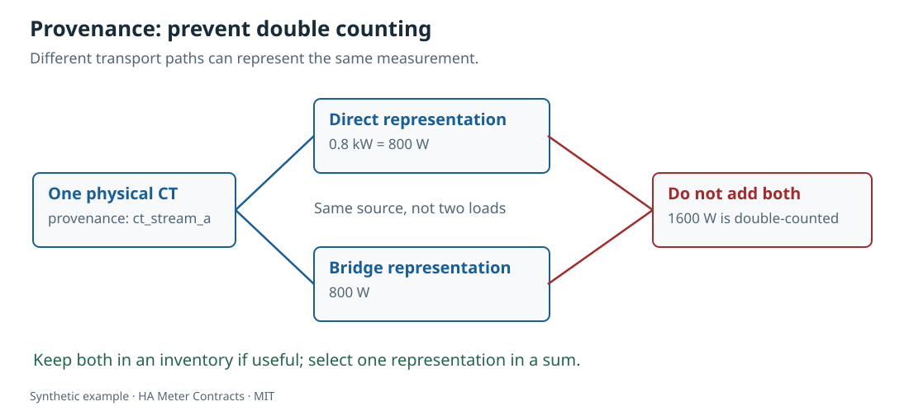
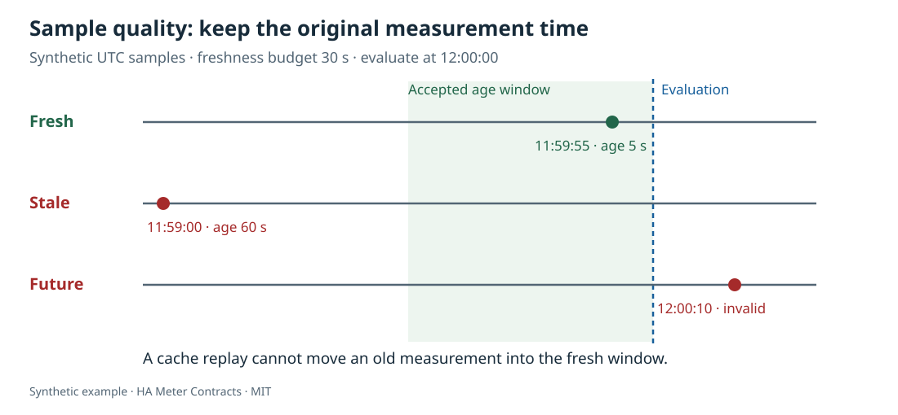

# Диагностика

<!-- language-navigation:start -->

<a href="../troubleshooting.md" lang="en" dir="ltr">English</a> ·
<a href="../ar/troubleshooting.md" lang="ar" dir="rtl">العربية</a> ·
<a href="../bn/troubleshooting.md" lang="bn" dir="ltr">বাংলা</a> ·
<a href="../cs/troubleshooting.md" lang="cs" dir="ltr">Čeština</a> ·
<a href="../de/troubleshooting.md" lang="de" dir="ltr">Deutsch</a> ·
<a href="../es/troubleshooting.md" lang="es" dir="ltr">Español</a> ·
<a href="../fa/troubleshooting.md" lang="fa" dir="rtl">فارسی</a> ·
<a href="../fr/troubleshooting.md" lang="fr" dir="ltr">Français</a> ·
<a href="../he/troubleshooting.md" lang="he" dir="rtl">עברית</a> ·
<a href="../hi/troubleshooting.md" lang="hi" dir="ltr">हिन्दी</a> ·
<a href="../id/troubleshooting.md" lang="id" dir="ltr">Bahasa Indonesia</a> ·
<a href="../it/troubleshooting.md" lang="it" dir="ltr">Italiano</a> ·
<a href="../ja/troubleshooting.md" lang="ja" dir="ltr">日本語</a> ·
<a href="../ko/troubleshooting.md" lang="ko" dir="ltr">한국어</a> ·
<a href="../nl/troubleshooting.md" lang="nl" dir="ltr">Nederlands</a> ·
<a href="../pl/troubleshooting.md" lang="pl" dir="ltr">Polski</a> ·
<a href="../pt/troubleshooting.md" lang="pt" dir="ltr">Português</a> ·
<a href="troubleshooting.md" lang="ru" dir="ltr">Русский</a> ·
<a href="../th/troubleshooting.md" lang="th" dir="ltr">ไทย</a> ·
<a href="../tr/troubleshooting.md" lang="tr" dir="ltr">Türkçe</a> ·
<a href="../uk/troubleshooting.md" lang="uk" dir="ltr">Українська</a> ·
<a href="../vi/troubleshooting.md" lang="vi" dir="ltr">Tiếng Việt</a> ·
<a href="../zh-Hans/troubleshooting.md" lang="zh-Hans" dir="ltr">简体中文</a> ·
<a href="../zh-Hant/troubleshooting.md" lang="zh-Hant" dir="ltr">繁體中文</a>

<!-- language-navigation:end -->

## Блок с тремя розетками не даёт три измерения мощности

`scope_outside` означает, что запрошенный индивидуальный результат использует более широкое измерение. Оставьте одну сущность всего блока. Если нужна индивидуальная мощность, добавьте независимые измерения правильных областей. Включённое реле не доказывает потребление нагрузки; потребление электричества насосом не доказывает течение воды.

## Перенесённый датчик удваивает сумму

Сам по себе `alias_stream` информационный. `duplicate_stream` означает, что обе копии вошли в сумму. Дайте копиям одного CT одинаковое происхождение и оставьте в сумме только одну. Не меняйте происхождение лишь ради подавления проверки.

## Правдоподобные отдельные числа, но нет числовой суммы

Проверьте `sample_stale`, `sample_future`, `sample_skew`, `sample_missing`, `incomplete_coverage`, `unit_dimension`, `scope_overlap`. Обновите исходный источник и сохраните время получения измерения. Расширение допустимого возраста — изменение политики, не исправление измерения. Полнота суммы оценивается по объявленным листьям, поэтому проверьте и само объявление.

## Энергия уменьшилась в полночь

Уменьшение может быть реальным сбросом, заменой или корректировкой. Объявите политику и добавьте `reset_at` из настоящего свидетельства источника. Время повторной передачи значения HA — не метка сброса. `total_increasing` не подходит для знаковой нетто-энергии. Два счётчика с разными началами не суммируются.

## Напряжение откалибровано, но ватты всё ещё различаются

Калибровка относится к конкретной величине. Поправка напряжения не подтверждает ток, фазовое соотношение, мощность или накопленную энергию. Поле коэффициента — только документация: значения должны уже содержать нужную поправку.

## Другой парсер принимает YAML, а этот — нет

Заключите метки времени в кавычки, удалите псевдонимы/якоря/пользовательские теги, повторные ключи и используйте конечные числа. Неизвестные поля считаются ошибкой для обнаружения опечаток. Ограничения действуют для обоих форматов. Если неоднозначные скаляры YAML неудобны, используйте JSON для обмена.

## Импорт HA не принимает временные метки

Укажите в `timestamp_attribute` настоящий атрибут времени измерения. `last_reported` доказывает только получение HA. Без исходного времени инструмент не может установить свежесть; оставьте отсчёт недоступным. Проблему токена или сетевого соединения искать не нужно: импорт офлайн.

## Безопасное сообщение об ошибке

Укажите версии пакета/Python, стабильные коды находок, минимальный синтетический контракт, выбранное `--at`, ожидаемый и фактический результат. Не прикладывайте полный экспорт HA, токен, реальный адрес, домашнее расписание или приватные идентификаторы устройств. В воспроизведении должны различаться 0 W и недоступный отсчёт.
